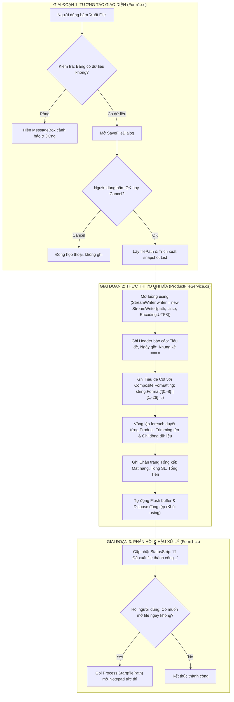

# KỊCH BẢN THUYẾT TRÌNH & BẢN BÁO CÁO CHUYÊN SÂU NHÓM 3
## ĐỀ TÀI: PRODUCT MANAGER (WINDOWS FORMS NÂNG CAO)
### NỘI DUNG YÊU CẦU BÁO CÁO THEO ĐỀ BÀI:
> **1. Demo thanh StatusStrip cập nhật tự động sau mỗi thao tác và chức năng Xuất file .txt.**  
> **2. Trình bày luồng xử lý I/O ghi file và công thức tính tổng tồn kho từ danh sách dữ liệu.**

---

# PHẦN 1: KỊCH BẢN THUYẾT TRÌNH TẬP TRUNG (DÙNG NÓI TRỰC TIẾP TRƯỚC LỚP & THẦY/CÔ)

* **Thời lượng đề xuất:** 5 – 7 phút
* **Phân công:** 1 bạn thuyết trình (nói theo kịch bản) + 1 bạn thao tác máy tính (bấm theo từng hành động).

---

### 🎤 LỜI MỞ ĐẦU (Khoảng 30 giây)

> *"Kính thưa Thầy/Cô và các bạn, hôm nay Nhóm 3 xin phép được trình bày và báo cáo phần chuyên sâu của nhóm trong bài Lab 06 Quản lý sản phẩm.  
> Nội dung báo cáo của nhóm em tập trung giải quyết trọn vẹn 2 yêu cầu trọng tâm:*  
> *1. **Demo thanh StatusStrip** tự động cập nhật phản hồi thời gian thực sau mỗi thao tác và **chức năng Xuất báo cáo file .txt**.*  
> *2. **Trình bày chi tiết luồng xử lý I/O ghi file** và **công thức toán học tính tổng giá trị tồn kho** trực tiếp từ danh sách dữ liệu.*  
> *Sau đây, em xin phép bắt đầu phần demo thực tế trên phần mềm."*

---

### 💻 MỤC 1: DEMO STATUSSTRIP TỰ ĐỘNG CẬP NHẬT & XUẤT FILE .TXT (3 - 4 phút)

*(Người thuyết trình vừa nói dõng dạc, người cầm máy tính vừa thao tác đúng nhịp)*

#### 🔹 Thao tác 1: Khởi động Form & Giới thiệu StatusStrip ban đầu
* **Thao tác máy tính:** Chạy ứng dụng (`F5`). Trỏ chuột vào thanh dưới cùng.
* **Lời thoại thuyết trình:**
  > *"Trước tiên, khi ứng dụng vừa khởi động, Thầy/Cô có thể quan sát ngay thanh **StatusStrip** ở góc dưới cùng màn hình.*  
  > *Thanh trạng thái được chia làm 4 thành phần rõ ràng:*  
  > *- Phía bên trái là nhãn thông điệp thao tác: Đang báo **'🟢 Sẵn sàng \| Đã nạp thành công 5 sản phẩm mẫu'**.*  
  > *- Kế tiếp là nhãn số lượng: Đang hiển thị **'📦 Mặt hàng: 5 \| Tổng SL tồn: 85 chiếc'**.*  
  > *- Kế tiếp là nhãn tài chính: **'💰 TỔNG TỒN KHO: 1.156.400.000 VNĐ'**.*  
  > *- Góc phải cùng là **đồng hồ ngày giờ hệ thống** tự động nhảy từng giây nhờ Timer."*

---

#### 🔹 Thao tác 2: StatusStrip cập nhật khi Xem (Click dòng)
* **Thao tác máy tính:** Click chọn lần lượt sản phẩm **SP01 (iPhone 15)** rồi sang **SP02 (MacBook Air)**.
* **Lời thoại thuyết trình:**
  > *"Khi em nhấp chuột chọn từng sản phẩm trên DataGridView, sự kiện `SelectionChanged` lập tức bắt được và StatusStrip phản hồi ngay lập tức:  
  > **'🔍 Đang xem chi tiết SP: [SP02] - MacBook Air M3 16GB'**.  
  > Nhờ đó, người dùng luôn biết rõ mình đang thao tác trên đối tượng nào mà không bị nhầm lẫn."*

---

#### 🔹 Thao tác 3: StatusStrip cập nhật khi Thêm mới sản phẩm
* **Thao tác máy tính:** 
  1. Bấm **➕ Thêm SP** (Chỉ cho Thầy/Cô thấy StatusStrip đổi sang: *'📝 Đang ở chế độ Thêm mới SP...'*).
  2. Nhập: Mã `SP06`, Tên `iPad Pro M4`, Loại `Máy tính bảng`, Đơn giá `25.000.000`, Số lượng `10`.
  3. Bấm **💾 Cập nhật**.
* **Lời thoại thuyết trình:**
  > *"Bây giờ em bấm 'Thêm SP'. StatusStrip lập tức hướng dẫn: 'Đang ở chế độ Thêm mới'.  
  > Em nhập sản phẩm mới SP06 có đơn giá 25 triệu và số lượng 10 chiếc.  
  > Khi em bấm 'Cập nhật', Thầy/Cô hãy để ý StatusStrip bên dưới:*  
  > *- Trạng thái báo: **'✅ Vừa thêm mới SP [SP06] thành công'**.*  
  > *- Số mặt hàng tự động tăng từ **5 lên 6**.*  
  > *- Tổng số lượng tồn tăng từ **85 lên 95 chiếc**.*  
  > *- Tổng giá trị tồn kho tự động cộng dồn thêm 250 triệu, từ **1.156.400.000 lên 1.406.400.000 VNĐ** hoàn toàn tự động theo thời gian thực!"*

---

#### 🔹 Thao tác 4: StatusStrip cập nhật khi Chỉnh sửa & Xóa
* **Thao tác máy tính:** 
  1. Chọn **SP06** vừa thêm $\rightarrow$ Bấm **✏️ Chỉnh sửa** $\rightarrow$ Giảm số lượng từ `10` xuống `2` $\rightarrow$ Bấm **Cập nhật**.
  2. Bấm **🗑️ Xóa** $\rightarrow$ Bấm **Yes**.
* **Lời thoại thuyết trình:**
  > *"Tương tự khi em bấm 'Chỉnh sửa' và giảm số lượng SP06 xuống còn 2 chiếc, StatusStrip lập tức giảm trừ tổng tiền tồn kho.  
  > Và khi em bấm 'Xóa', thông điệp báo: **'🗑️ Đã xóa sản phẩm SP06 khỏi hệ thống'**, tổng số mặt hàng và tổng tiền kho tự động khấu trừ ngay lập tức."*

---

#### 🔹 Thao tác 5: StatusStrip tự động tính tồn kho riêng khi Lọc / Tìm kiếm (Điểm cộng đặc biệt)
* **Thao tác máy tính:** Tại ComboBox *Lọc loại SP*, chọn **"Điện thoại"**.
* **Lời thoại thuyết trình:**
  > *"Đặc biệt nhất, khi em lọc xem riêng nhóm **'Điện thoại'**, DataGridView chỉ hiển thị 2 sản phẩm điện thoại.  
  > Lúc này, **StatusStrip tự động tính toán lại riêng cho nhóm đang lọc**:  
  > Mặt hàng còn 2, tổng số lượng 27 chiếc và tổng tồn kho là **773.730.000 VNĐ**.  
  > Khi bấm 'Bỏ lọc', toàn bộ số liệu tổng thể của kho hàng lập tức được khôi phục nguyên vẹn!"*

---

#### 🔹 Thao tác 6: Demo Chức năng Xuất File `.txt`
* **Thao tác máy tính:** 
  1. Bấm nút **💾 Xuất File (Report)**.
  2. Chọn kiểu file: `File văn bản báo cáo (*.txt)` $\rightarrow$ Bấm **Save**.
  3. Hộp thoại hỏi *"Bạn có muốn mở file ngay không?"* $\rightarrow$ Chọn **Yes**.
  4. Cửa sổ Notepad mở lên: phóng to cho Thầy/Cô xem.
* **Lời thoại thuyết trình:**
  > *"Tiếp theo là chức năng **Xuất file báo cáo .txt**:  
  > Em bấm 'Xuất File', hộp thoại `SaveFileDialog` hiện lên gợi ý sẵn tên file có gắn ngày giờ.  
  > Sau khi lưu xong, chương trình tự động hỏi và mở ngay file Notepad:  
  > Quý Thầy/Cô có thể thấy tệp văn bản này được nhóm em định dạng cực kỳ chuyên nghiệp:*  
  > *- Có tiêu đề, ngày giờ xuất báo cáo.*  
  > *- Các cột Mã SP, Tên SP, Loại, Đơn giá, Tồn kho... **được căn lề thẳng hàng tuyệt đối** như một bảng in kế toán, không hề bị xô lệch.*  
  > *- Phía chân trang có phần **TỔNG KẾT BÁO CÁO** chốt đúng tổng số lượng và tổng giá trị tồn kho khớp 100% với trên màn hình phần mềm."*

---

# PHẦN 2: TRÌNH BÀY LÝ THUYẾT & NGUYÊN LÝ KỸ THUẬT (DÙNG ĐỂ BÁO CÁO & TRẢ LỜI CÂU HỎI)

---

### 🧠 MỤC 2: CÔNG THỨC TOÁN HỌC & THUẬT TOÁN TÍNH TỔNG TỒN KHO

#### 1. Công thức toán học:
Tổng giá trị tài sản tồn kho của cửa hàng là tổng tích số giữa **Số lượng tồn** và **Đơn giá** của từng mặt hàng thứ $i$ trong danh sách:

$$\text{Tổng Giá Trị Tồn Kho} = \sum_{i=1}^{n} \Big( \text{Số Lượng}_i \times \text{Đơn Giá}_i \Big)$$

*Trong đó:*
* $n$: Tổng số mặt hàng đang quản lý (hoặc đang lọc).
* $\text{Số Lượng}_i$: Số lượng tồn thực tế của sản phẩm thứ $i$ (kiểu `int`).
* $\text{Đơn Giá}_i$: Đơn giá niêm yết của sản phẩm thứ $i$ (kiểu `decimal`).

---

#### 2. Thuật toán thực thi trong mã nguồn (`Form1.cs`):
```csharp
private void CapNhatThongKeStatusStrip(string? thongDiepTrangThai = null)
{
    // 1. Cập nhật thông điệp hành động vừa thực hiện lên góc trái StatusStrip
    if (!string.IsNullOrEmpty(thongDiepTrangThai))
    {
        lblTrangThai.Text = thongDiepTrangThai;
    }

    // 2. Thuật toán tính toán chỉ số thống kê tồn kho
    int soMatHang = _bindingSource.Count;
    int tongSoLuongTon = 0;
    decimal tongGiaTriTonKho = 0;

    // Duyệt qua từng sản phẩm trong nguồn dữ liệu hiện tại
    foreach (Product sp in _bindingSource)
    {
        tongSoLuongTon += sp.SoLuong;
        decimal thanhTien = sp.SoLuong * sp.DonGia; // Công thức: SL * Đơn giá
        tongGiaTriTonKho += thanhTien;
    }

    // 3. Hiển thị trực tiếp các chỉ số thống kê lên các nhãn của StatusStrip
    lblTongSanPham.Text = $"📦 Mặt hàng: {soMatHang} | Tổng SL tồn: {tongSoLuongTon:N0} chiếc";
    lblTongGiaTriTonKho.Text = $"💰 TỔNG TỒN KHO: {tongGiaTriTonKho:N0} VNĐ";
}
```

#### 🔍 3 Điểm kỹ thuật đắt giá cần nhấn mạnh với Giảng viên:
1. **Duyệt qua `_bindingSource` thay vì danh sách tĩnh `_danhSachGoc`:**  
   *Nhờ duyệt qua `_bindingSource`, khi người dùng lọc hay tìm kiếm sản phẩm, thuật toán tự động tính toán tổng tồn kho **riêng cho tập sản phẩm đang hiển thị**, mang lại tính thực tiễn quản trị rất cao.*
2. **Sử dụng kiểu dữ liệu `decimal`:**  
   *`decimal` là kiểu số thực 128-bit cơ số 10 chuyên dụng cho tài chính kế toán, loại bỏ 100% sai số làm tròn số học nhị phân (vốn hay xảy ra trên kiểu `double` hay `float`).*
3. **Định dạng số hiển thị `{...:N0}`:**  
   *Tự động phân cách hàng nghìn bằng dấu phẩy theo chuẩn quốc tế (ví dụ: `1,406,400,000 VNĐ`), giúp giao diện trực quan và chuyên nghiệp.*

---

### 💾 MỤC 3: TRÌNH BÀY LUỒNG XỬ LÝ I/O GHI FILE

Luồng ghi file được chia tách thành **3 giai đoạn** chuẩn mực theo mô hình kiến trúc phần mềm:



---

#### Chi tiết kỹ thuật mã nguồn ghi file `.txt` (`ProductFileService.cs`):

```csharp
public static void ExportToTxt(string filePath, IEnumerable<Product> products)
{
    // 1. Quản lý tài nguyên an toàn bằng khối using và bộ mã hóa UTF-8
    using (StreamWriter writer = new StreamWriter(filePath, false, Encoding.UTF8))
    {
        // 2. Ghi phần Header trang trí
        writer.WriteLine("====================================================================================================");
        writer.WriteLine("                         BÁO CÁO THỐNG KÊ TỒN KHO VÀ DANH SÁCH SẢN PHẨM                            ");
        writer.WriteLine($"Ngày xuất báo cáo : {DateTime.Now:dd/MM/yyyy HH:mm:ss}");
        writer.WriteLine("----------------------------------------------------------------------------------------------------");

        // 3. Ghi tiêu đề cột bằng Composite Formatting căn lề
        // {0,-8}: Căn trái 8 ký tự | {3,18}: Căn phải 18 ký tự
        writer.WriteLine(string.Format("{0,-8} | {1,-26} | {2,-18} | {3,18} | {4,12} | {5,-16} | {6,-14}",
            "Mã SP", "Tên Sản Phẩm", "Loại SP", "Đơn Giá (VNĐ)", "SL Tồn Kho", "Ngày Nhập", "Kinh Doanh"));
        writer.WriteLine("----------------------------------------------------------------------------------------------------");

        int tongSoLuongSP = 0;
        decimal tongGiaTriTonKho = 0;
        int demSanPham = 0;

        // 4. Duyệt danh sách và ghi từng dòng dữ liệu
        foreach (var p in products)
        {
            demSanPham++;
            tongSoLuongSP += p.SoLuong;
            tongGiaTriTonKho += (p.SoLuong * p.DonGia);

            string trangThaiKD = p.ConKinhDoanh ? "Đang bán" : "Ngừng bán";

            // Cắt ngắn nếu tên quá 24 ký tự để giữ bảng luôn thẳng hàng
            string tenHienThi = p.TenSP.Length > 24 ? p.TenSP.Substring(0, 21) + "..." : p.TenSP;

            writer.WriteLine(string.Format("{0,-8} | {1,-26} | {2,-18} | {3,18:N0} | {4,12:N0} | {5,-16:dd/MM/yyyy} | {6,-14}",
                p.MaSP, tenHienThi, p.LoaiSP, p.DonGia, p.SoLuong, p.NgayNhap, trangThaiKD));
        }

        // 5. Ghi phần chân trang tổng kết báo cáo
        writer.WriteLine("====================================================================================================");
        writer.WriteLine("TỔNG KẾT BÁO CÁO:");
        writer.WriteLine($"- Tổng số mặt hàng (mã sản phẩm) : {demSanPham} mặt hàng");
        writer.WriteLine($"- Tổng số lượng sản phẩm tồn kho : {tongSoLuongSP:N0} cái/chiếc");
        writer.WriteLine($"- TỔNG GIÁ TRỊ TỒN KHO            : {tongGiaTriTonKho:N0} VNĐ");
        writer.WriteLine("====================================================================================================");
    } // Kết thúc khối using: Tự động Flush() và Close() file an toàn
}
```

---

### 🏆 4 ƯU ĐIỂM KỸ THUẬT VƯỢT TRỘI CỦA LUỒNG GHI FILE (DÙNG ĐỂ ĂN ĐIỂM TỐI ĐA)

1. **Bảo vệ tài nguyên bằng `using`:** Đảm bảo luồng tệp tin luôn được xả đệm (`Flush`) và đóng (`Close/Dispose`) ngay lập tức, ngay cả khi gặp sự cố đứt quãng, không bao giờ bị lỗi khóa file (File Lock) trên Windows.
2. **Kỹ thuật căn lề Composite Formatting `{index, width}`:** Thay vì dùng dấu Tab `\t` dễ làm xô lệch các cột khi tên sản phẩm dài ngắn khác nhau, nhóm dùng độ rộng cố định giúp các cột thẳng tắp tuyệt đối.
3. **Cắt chuỗi thông minh (Safe Trimming):** Giới hạn độ dài tên sản phẩm tối đa 24 ký tự kèm dấu `...` để bảng báo cáo luôn ngay ngắn trên trang in.
4. **Tích hợp `Process.Start`:** Sau khi xuất file, ứng dụng hiển thị hộp thoại hỏi và tự động mở file bằng Notepad giúp người dùng nghiệm thu kết quả tức thì mà không cần tự tìm đường dẫn.

---

### 🎤 LỜI KẾT BÁO CÁO (Khoảng 20 giây)

> *"Kính thưa Thầy/Cô, trên đây là toàn bộ phần trình bày và demo trực tiếp của Nhóm 3 về **StatusStrip Real-time**, **Thuật toán tính tồn kho** và **Luồng I/O xuất báo cáo file .txt**.  
> Nhóm 3 đã giải quyết trọn vẹn cả về mặt giao diện người dùng lẫn độ chuẩn xác của thuật toán và an toàn tài nguyên hệ thống.  
> Em xin chân thành cảm ơn Thầy/Cô đã theo dõi và nhóm em sẵn sàng lắng nghe các câu hỏi góp ý ạ!"*
