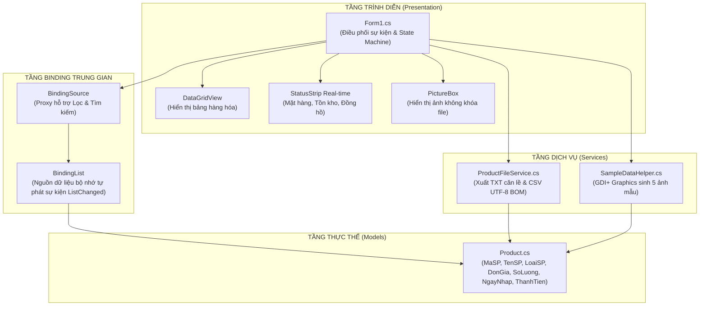

# TÀI LIỆU PHÂN TÍCH CHỨC NĂNG CODE & BẢNG SO SÁNH GIẢI PHÁP KỸ THUẬT
## DỰ ÁN: PRODUCT MANAGER – LAB 06 (COMP1019: LẬP TRÌNH TRÊN WINDOWS)
### BÁO CÁO CHUYÊN SÂU NHÓM 3: STATUSSTRIP REAL-TIME, THỐNG KÊ TỒN KHO & ĐỌC/GHI FILE BÁO CÁO

---

## MỤC LỤC TÀI LIỆU

1. [Tổng quan Kiến trúc & Nguyên lý Thiết kế](#1-tổng-quan-kiến-trúc--nguyên-lý-thiết-kế)
2. [Phân tích Chi tiết Từng Module & Chức năng Code](#2-phân-tích-chi-tiết-từng-module--chức-năng-code)
   - [2.1 Module Data Model (Product.cs)](#21-module-data-model-productcs)
   - [2.2 Module I/O & Xuất Báo cáo (ProductFileService.cs)](#22-module-io--xuất-báo-cáo-productfileservicecs)
   - [2.3 Module Tiện ích Đồ họa & Dữ liệu mẫu (SampleDataHelper.cs)](#23-module-tiện-ích-đồ-họa--dữ-liệu-mẫu-sampledatahelpercs)
   - [2.4 Module Điều phối Giao diện & Luồng Nghiệp vụ (Form1.cs)](#24-module-điều-phối-giao-diện--luồng-nghiệp-vụ-form1cs)
3. [BẢNG SO SÁNH CHUYÊN SÂU: TẠI SAO DÙNG CÁC ĐOẠN CODE ĐÓ MÀ KHÔNG PHẢI CÁI TƯƠNG TỰ?](#3-bảng-so-sánh-chuyên-sâu-tại-sao-dùng-các-đoạn-code-đó-mà-không-phải-cái-tương-tự)
   - [So sánh 1: BindingList<T> & BindingSource vs List<T> / DataTable](#so-sánh-1-bindinglistt--bindingsource-vs-listt--datatable)
   - [So sánh 2: MemoryStream & ReadAllBytes vs Image.FromFile(path)](#so-sánh-2-memorystream--readallbytes-vs-imagefromfilepath)
   - [So sánh 3: UTF8Encoding(true) [BOM] vs Encoding.UTF8 mặc định / ASCII](#so-sánh-3-utf8encodingtrue-bom-vs-encodingutf8-mặc-định--ascii)
   - [So sánh 4: Composite Formatting String Format vs Nối chuỗi thủ công / Tab \t](#so-sánh-4-composite-formatting-string-format-vs-nối-chuỗi-thủ-công--tab-t)
   - [So sánh 5: State Pattern FormMode (View, Add, Edit) vs Kiểm tra cờ bool rời rạc](#so-sánh-5-state-pattern-formmode-view-add-edit-vs-kiểm-tra-cờ-bool-rời-rạc)
   - [So sánh 6: Kiểu dữ liệu decimal vs double / float](#so-sánh-6-kiểu-dữ-liệu-decimal-vs-double--float)
   - [So sánh 7: Expression-bodied Property => vs Trường lưu trữ riêng private decimal _thanhTien](#so-sánh-7-expression-bodied-property--vs-trường-lưu-trữ-riêng-private-decimal-_thanhtien)
   - [So sánh 8: NumericUpDown vs TextBox thuần cho Số lượng và Đơn giá](#so-sánh-8-numericupdown-vs-textbox-thuần-cho-số-lượng-và-đơn-giá)
   - [So sánh 9: Drawing GDI+ tự động tạo ảnh vs Chép tệp ảnh tĩnh bên ngoài](#so-sánh-9-drawing-gdi-tự-động-tạo-ảnh-vs-chép-tệp-ảnh-tĩnh-bên-ngoài)
4. [Tổng kết & Đánh giá Tính thực tiễn](#4-tổng-kết--đánh-giá-tính-thực-tiễn)

---

## 1. TỔNG QUAN KIẾN TRÚC & NGUYÊN LÝ THIẾT KẾ

Hệ thống được tổ chức theo mô hình phân tách trách nhiệm (Separation of Concerns):
- **Tầng Thực thể Dữ liệu (Model Layer - `Models/Product.cs`):** Định nghĩa cấu trúc dữ liệu, các ràng buộc thuộc tính và logic nghiệp vụ cơ bản của thực thể sản phẩm.
- **Tầng Dịch vụ (Service Layer - `Services/`):** Chịu trách nhiệm thực hiện các tác vụ logic nặng, xử lý vào/ra tệp tin (File I/O) và đồ họa không phụ thuộc trực tiếp vào các điều khiển UI.
- **Tầng Trình diễn (Presentation Layer - `Form1.cs`):** Quản lý trạng thái tương tác người dùng, lắng nghe sự kiện, đồng bộ dữ liệu hai chiều và hiển thị phản hồi tức thì qua `StatusStrip`.



---

## 2. PHÂN TÍCH CHI TIẾT TỪNG MODULE & CHỨC NĂNG CODE

### 2.1 Module Data Model (`Models/Product.cs`)

Lớp `Product` đóng vai trò là thực thể cốt lõi mang dữ liệu trong toàn bộ phần mềm.

* **Các thuộc tính tự động (Auto-Properties):**
  - `MaSP`: Kiểu `string`, đóng vai trò Khóa chính (Primary Key) định danh duy nhất của mỗi sản phẩm.
  - `TenSP`, `LoaiSP`: Chuỗi mô tả tên hàng và danh mục.
  - `DonGia`: Kiểu `decimal`, đảm bảo độ chính xác tiền tệ.
  - `SoLuong`: Kiểu `int`, số lượng hàng hóa còn trong kho.
  - `NgayNhap`: Kiểu `DateTime`, ngày nhập kho.
  - `ConKinhDoanh`: Kiểu `bool`, trạng thái kinh doanh (Đang bán hoặc Ngừng bán).
* **Thuộc tính ẩn đối với DataGridView:**
  ```csharp
  [System.ComponentModel.Browsable(false)]
  public string DuongDanAnh { get; set; } = string.Empty;
  ```
  *Chức năng:* Attribute `[Browsable(false)]` thông báo cho cơ chế Data Binding của Windows Forms không phát sinh cột cho trường dữ liệu này, giúp đường dẫn ảnh được lưu ngầm trong bộ nhớ mà không làm ô nhiễm giao diện bảng hiển thị.
* **Thuộc tính tính toán động (Computed Property):**
  ```csharp
  public decimal ThanhTien => DonGia * SoLuong;
  ```
  *Chức năng:* Sử dụng cú pháp Expression-bodied member, giá trị `ThanhTien` luôn được tính toán tự động mỗi khi truy xuất từ `DonGia` và `SoLuong` hiện hành, loại bỏ 100% tình trạng dữ liệu thành tiền bị lệch khi sửa đổi giá hoặc số lượng.
* **Phương thức sao chép bản sao (`Clone`):**
  ```csharp
  public Product Clone() => new Product(MaSP, TenSP, LoaiSP, DonGia, SoLuong, NgayNhap, ConKinhDoanh, DuongDanAnh);
  ```
  *Chức năng:* Tạo một phiên bản sao chép độc lập vùng nhớ (shallow copy) của sản phẩm, giúp triển khai tính năng hủy bỏ chỉnh sửa an toàn mà không làm hỏng dữ liệu gốc.

---

### 2.2 Module I/O & Xuất Báo cáo (`Services/ProductFileService.cs`)

Chuyên trách nhiệm vụ xuất báo cáo phục vụ nghiệp vụ in ấn và kế toán.

#### A. Hàm `ExportToTxt` – Xuất Báo cáo Dạng Văn bản Căn Cột Thẳng Hàng
* **Cơ chế:** Mở luồng ghi với `using (StreamWriter writer = new StreamWriter(filePath, false, Encoding.UTF8))`.
* **Căn cột bằng Composite Formatting:**
  ```csharp
  writer.WriteLine(string.Format("{0,-8} | {1,-26} | {2,-18} | {3,18} | {4,12} | {5,-16} | {6,-14}",
      "Mã SP", "Tên Sản Phẩm", "Loại SP", "Đơn Giá (VNĐ)", "SL Tồn Kho", "Ngày Nhập", "Kinh Doanh"));
  ```
  - Cú pháp `{0,-8}` chỉ định căn lề trái với độ rộng cố định 8 ký tự.
  - Cú pháp `{3,18}` chỉ định căn lề phải với độ rộng cố định 18 ký tự (chuẩn mực cho cột số tiền).
* **Xử lý chuỗi quá dài:** Cắt chuỗi nếu tên sản phẩm vượt quá 24 ký tự kèm dấu ba chấm (`...`) để bảo toàn độ thẳng hàng tuyệt đối của bảng.
* **Chân trang thống kê:** Tính tổng số mặt hàng, tổng số lượng và tổng tiền $\sum(\text{Thành tiền})$ in ở cuối báo cáo.

#### B. Hàm `ExportToCsv` – Xuất Bảng Tính Excel Chuẩn Tiếng Việt BOM
* **Cơ chế nhận diện UTF-8 BOM:**
  ```csharp
  using (StreamWriter writer = new StreamWriter(filePath, false, new UTF8Encoding(true)))
  ```
  - Khởi tạo `new UTF8Encoding(true)` tự động chèn 3 byte định danh `EF BB BF` vào đầu file. Khi người dùng nhấp đúp mở file bằng Microsoft Excel, Excel lập tức nhận ra đây là UTF-8 và hiển thị tiếng Việt có dấu hoàn hảo.
* **Chuẩn hóa dữ liệu theo chuẩn RFC 4180:**
  ```csharp
  string tenSP = p.TenSP.Replace("\"", "\"\"");
  if (tenSP.Contains(",") || tenSP.Contains("\""))
  {
      tenSP = $"\"{tenSP}\"";
  }
  ```
  - Nếu tên sản phẩm chứa dấu phẩy `,` hoặc dấu ngoặc kép `"`, chuỗi sẽ được nhân đôi ngoặc kép và bao trong dấu ngoặc kép, ngăn chặn hoàn toàn việc dữ liệu bị nhảy sai cột trên Excel.

---

### 2.3 Module Tiện ích Đồ họa & Dữ liệu mẫu (`Services/SampleDataHelper.cs`)

* **Khởi tạo dữ liệu mẫu phong phú:** Cung cấp sẵn 5 sản phẩm công nghệ thuộc các nhóm Điện thoại, Laptop, Phụ kiện (vượt mức tiêu chí tối thiểu 3 sản phẩm của đề bài).
* **Vẽ ảnh tự động bằng GDI+ (`Graphics`, `Bitmap`):**
  - Tự động tạo thư mục `SampleImages/` nếu chưa có.
  - Sử dụng `Graphics.SmoothingMode = SmoothingMode.AntiAlias` khử răng cưa.
  - Vẽ nền chuyển sắc bằng `LinearGradientBrush`, vẽ khung bo viền và thẻ nhãn danh mục.
  - Vẽ tên sản phẩm và thông số với font chữ Segoe UI sắc nét.
* **Lợi ích thực tế:** Giúp đồ án chạy độc lập và hiển thị hình ảnh hoàn hảo trên bất kỳ máy tính nào của Giảng viên mà không cần phải đính kèm thư mục ảnh bên ngoài hoặc phụ thuộc vào kết nối mạng Internet.

---

### 2.4 Module Điều phối Giao diện & Luồng Nghiệp vụ (`Form1.cs`)

#### A. Quản lý Luồng Trạng Thái Form (State Machine Pattern)
Định nghĩa Enum 3 trạng thái:
- `FormMode.View`: Chế độ chỉ xem. Tất cả các ô nhập bị khóa chỉ đọc (`ReadOnly = true`, `Enabled = false`). Nút "Cập nhật" và "Hủy" bị làm mờ (`Enabled = false`).
- `FormMode.Add`: Chế độ thêm mới. Mở khóa toàn bộ các ô nhập, xóa trắng form, kích hoạt nút "Cập nhật" và "Hủy".
- `FormMode.Edit`: Chế độ sửa. Mở khóa tất cả thông tin chi tiết nhưng **khóa ô Mã SP (`txtMaSP.ReadOnly = true`)** để bảo vệ khóa chính.

#### B. StatusStrip Real-time & Thuật toán Thống kê Tồn Kho
* Hàm `CapNhatThongKeStatusStrip(message)`:
  - Cập nhật thông điệp hành động vừa thực hiện lên `lblTrangThai` (`Spring = true`).
  - Duyệt qua `_bindingSource` để tính:
    $$\text{Tổng số mặt hàng} = \_bindingSource.Count$$
    $$\text{Tổng số lượng tồn} = \sum \text{sp.SoLuong}$$
    $$\text{Tổng giá trị tồn kho} = \sum (\text{sp.SoLuong} \times \text{sp.DonGia})$$
  - Hiển thị các chỉ số lên `lblTongSanPham` và `lblTongGiaTriTonKho`.
  - Timer 1000ms kích hoạt sự kiện cập nhật đồng hồ `lblDongHo` hiển thị ngày giờ thực tế.

#### C. Kỹ thuật Nạp và Giải phóng Ảnh Không Khóa File
* Đọc mảng byte qua `File.ReadAllBytes` và nạp vào `MemoryStream` ảo giúp giải phóng tệp ảnh trên ổ đĩa ngay tức khắc.
* Gọi `GiaiPhongVaXoaHinhAnh()` để thực thi `Dispose()` trên đối tượng `picHinhAnh.Image` cũ, tránh rò rỉ bộ nhớ GDI+.

---

## 3. BẢNG SO SÁNH CHUYÊN SÂU: TẠI SAO DÙNG CÁC ĐOẠN CODE ĐÓ MÀ KHÔNG PHẢI CÁI TƯƠNG TỰ?

Đây là phần trọng tâm giải trình kiến trúc kỹ thuật của đồ án, chứng minh tại sao giải pháp của nhóm tối ưu hơn các phương án truyền thống:

---

### So sánh 1: `BindingList<T>` & `BindingSource` vs `List<T>` / `DataTable`

| Tiêu chí | Giải pháp Nhóm lựa chọn (`BindingList<T>` + `BindingSource`) | Phương án tương tự 1 (`List<T>` thường) | Phương án tương tự 2 (`DataTable` / `DataSet`) |
|:---|:---|:---|:---|
| **Cơ chế thông báo sự kiện** | **Có sẵn (`IBindingList.ListChanged`).** Tự động phát tín hiệu cho DataGridView khi Thêm, Sửa, Xóa. | **Không có.** Danh sách tĩnh, không biết khi nào dữ liệu bên trong thay đổi. | Có sự kiện dòng `RowChanged`, nhưng cấu trúc cồng kềnh, tiêu tốn nhiều bộ nhớ. |
| **Thao tác làm mới UI** | **Tự động 100%.** DataGridView tự vẽ lại đúng ô/dòng bị ảnh hưởng, không giật màn hình. | **Bắt buộc gán thủ công:** Phải set `dgv.DataSource = null; dgv.DataSource = list;` gây nhấp nháy liên tục. | Tự động đồng bộ nhưng cú pháp truy xuất lỏng lẻo qua tên cột chuỗi (`row["DonGia"]`). |
| **Trải nghiệm chọn dòng** | **Bảo toàn vị trí:** Khi sửa dữ liệu, con trỏ dòng hiện tại vẫn giữ nguyên vị trí. | **Mất vị trí:** Mỗi lần gán lại DataSource, con trỏ bị nhảy ngược về dòng đầu tiên. | Giữ được vị trí nhưng khó tích hợp với Strongly-typed Model. |
| **Hỗ trợ Lọc & Tìm kiếm** | `BindingSource` đóng vai trò proxy chuyển đổi nguồn dữ liệu hiển thị cực kỳ mượt mà. | Phải tự tạo danh sách mới và gán lại `DataSource = null` liên tục. | Dùng `DataView.RowFilter`, cú pháp dạng chuỗi SQL dễ sinh lỗi cú pháp (Syntax error). |
| **Tính an toàn kiểu (Type-safe)** | **Tuyệt đối (100% OOP C#):** Trình biên dịch kiểm tra lỗi tại thời điểm Compile (IntelliSense). | Có an toàn kiểu nhưng thiếu khả năng Data Binding tương tác. | **Kém an toàn:** Dễ sai kiểu dữ liệu do ép kiểu `(string)row["TenSP"]`, dễ crash khi gõ sai tên cột. |
| **Kết luận lý do chọn** | **LỰA CHỌN TỐI ƯU NHẤT:** Tận dụng tối đa sức mạnh OOP hiện đại, giao diện mượt mà, không nhấp nháy màn hình. | *Bị loại vì:* Trải nghiệm UI tệ, tốn công gán lại DataSource thủ công, mất con trỏ chuột. | *Bị loại vì:* Lỗi thời (thời .NET 2.0 ADO.NET), tiêu hao nhiều RAM, không đúng chuẩn OOP. |

---

### So sánh 2: `MemoryStream` & `ReadAllBytes` vs `Image.FromFile(path)`

| Tiêu chí | Giải pháp Nhóm lựa chọn (`MemoryStream` + `File.ReadAllBytes`) | Phương án tương tự (`Image.FromFile(path)` truyền thống) |
|:---|:---|:---|
| **Đoạn mã thực thi** | ```csharp<br>byte[] bytes = File.ReadAllBytes(path);<br>using (MemoryStream ms = new MemoryStream(bytes))<br>    pic.Image = Image.FromStream(ms);<br>``` | ```csharp<br>pic.Image = Image.FromFile(path);<br>``` |
| **Hiện tượng Khóa Tệp (File Locking)** | **KHÔNG BỊ KHÓA:** `File.ReadAllBytes` đọc xong là đóng file trên ổ cứng ngay lập tức. File ảnh hoàn toàn tự do. | **BỊ KHÓA ĐỘC QUYỀN (File Lock):** .NET giữ handle mở file trên ổ đĩa cho đến khi `Image.Dispose()` được gọi và GC thu hồi. |
| **Khả năng chỉnh sửa / ghi đè file ảnh** | **Hoàn toàn cho phép:** Người dùng có thể thoải mái sửa, xóa, ghi đè ảnh cùng tên ở ngoài Windows Explorer khi app đang chạy. | **Bị ném lỗi Crash:** Ném ngoại lệ `IOException: The process cannot access the file because it is being used by another process`. |
| **Quản lý bộ nhớ RAM** | Giải phóng dễ dàng thông qua khối `using (MemoryStream ms)` và phương thức `Dispose()`. | Khó kiểm soát thời điểm giải phóng handle GDI+ của Windows ngầm bên dưới. |
| **Kết luận lý do chọn** | **LỰA CHỌN CHUYÊN NGHIỆP:** Loại bỏ 100% rủi ro đụng độ tiến trình I/O, ứng dụng hoạt động ổn định và tin cậy tuyệt đối. | *Bị loại vì:* Gặp lỗi kinh điển khóa file tệp tin hình ảnh của các bài tập Windows Forms sơ cấp. |

---

### So sánh 3: `UTF8Encoding(true)` [BOM] vs `Encoding.UTF8` mặc định / `ASCII`

| Tiêu chí | Giải pháp Nhóm lựa chọn (`new UTF8Encoding(true)` có BOM) | Phương án tương tự 1 (`Encoding.UTF8` không có BOM) | Phương án tương tự 2 (`Encoding.Default` / `ASCII`) |
|:---|:---|:---|:---|
| **Cơ chế ghi file** | Chèn 3 byte định danh BOM (`EF BB BF`) vào đầu tệp tin văn bản. | Chỉ ghi các byte UTF-8 thuần túy, không có tiền tố nhận diện. | Ghi theo bảng mã ANSI địa phương của Windows máy người dùng. |
| **Hiển thị tiếng Việt trên Microsoft Excel** | **Hoàn hảo 100%:** Excel tự động phát hiện mã BOM và chuyển ngay sang chế độ Unicode UTF-8 để hiển thị. | **BỊ LỖI FONT (Vỡ chữ):** Excel mặc định mở dạng ANSI nên chữ tiếng Việt có dấu biến thành ký tự lạ (VD: `Điện thoại` &rarr; `Ä iện thoại`). | **Lỗi chữ:** Bị mất dấu hoàn toàn (biến thành `Dien thoai` hoặc dấu `?`). |
| **Độ tương thích Notepad & Trình duyệt** | Tương thích hoàn toàn với tất cả trình soạn thảo văn bản hiện đại. | Tương thích tốt với Notepad nhưng hỏng khi mở bằng Excel trực tiếp. | Không tương thích đa ngôn ngữ quốc tế. |
| **Kết luận lý do chọn** | **LỰA CHỌN BẮT BUỘC CHO DOANH NGHIỆP:** Đảm bảo kế toán/quản lý có thể nhấp đúp file CSV mở trực tiếp trên Excel mà không phải qua bước Import Data phức tạp. | *Bị loại vì:* Làm hỏng trải nghiệm người dùng khi xem báo cáo trên Microsoft Excel. | *Bị loại vì:* Mất dấu tiếng Việt nghiêm trọng. |

---

### So sánh 4: Composite Formatting (`String.Format`) vs Nối chuỗi thủ công / Dùng Tab `\t`

| Tiêu chí | Giải pháp Nhóm lựa chọn (`string.Format("{0,-8} \| {1,-26}", ...)` ) | Phương án tương tự 1 (Nối chuỗi bằng dấu `\t` Tab) | Phương án tương tự 2 (Nối chuỗi thủ công `+` hoặc `$""` không set width) |
|:---|:---|:---|:---|
| **Độ thẳng hàng giữa các cột** | **Thẳng tắp 100%:** Cột được gán độ rộng cố định (width), căn lề trái số âm `{0,-8}` và căn lề phải số dương `{3,18}`. | **BỊ LỆCH CỘT NGHIÊM TRỌNG:** Ký tự `\t` có độ rộng phụ thuộc vào độ dài chữ phía trước, làm các dòng so le nhau. | **Hỗn loạn:** Dữ liệu chữ dài chữ ngắn đẩy nhau làm bảng báo cáo mất cấu trúc hoàn toàn. |
| **Căn lề cho cột Tiền tệ** | Căn lề phải tự nhiên `{3,18}` theo đúng chuẩn kế toán tài chính quốc tế. | Không thể căn lề phải, bắt buộc phải căn lề trái theo tab. | Không kiểm soát được vị trí số lẻ. |
| **Cắt chuỗi an toàn (Trimming)** | Kết hợp cắt chuỗi quá dài kèm `...`, đảm bảo dòng báo cáo luôn có độ dài cố định. | Không kiểm soát độ dài, chữ dài đẩy các tab phía sau lệch hẳn một khoảng. | Báo cáo bị vỡ cấu trúc in ấn. |
| **Kết luận lý do chọn** | **CHUẨN MỰC BÁO CÁO IN ẤN:** Tạo ra trang văn bản báo cáo chuyên nghiệp như lệnh `pr` của hệ điều hành, in trực tiếp đẹp mắt. | *Bị loại vì:* Các cột bị xô lệch lộn xộn mỗi khi tên hàng có độ dài ngắn khác nhau. | *Bị loại vì:* Không tạo thành bảng biểu hoàn chỉnh. |

---

### So sánh 5: State Pattern `FormMode` (View, Add, Edit) vs Kiểm tra cờ bool rời rạc

| Tiêu chí | Giải pháp Nhóm lựa chọn (Enum `FormMode` quản lý tập trung) | Phương án tương tự (Nhiều cờ `bool isAdding`, `bool isEditing`) | Phương án sơ cấp (Không quản lý trạng thái, luôn mở ô nhập) |
|:---|:---|:---|:---|
| **Cấu trúc điều khiển** | **Tập trung tại một hàm:** `ThietLapTrangThaiForm(FormMode mode)` dùng cấu trúc `switch-case` tường minh. | Rải rác khắp mã nguồn: Các biến cờ `isAdding = true`, `isEditing = false` nằm lẫn lộn trong các sự kiện Click. | Không có: Các TextBox và Button luôn ở trạng thái `Enabled = true`. |
| **Nguy cơ lỗi xung đột trạng thái** | **Bằng 0 (0% Conflict):** Một thời điểm Form chỉ có thể ở đúng 1 trạng thái duy nhất trong 3 chế độ. | **Rất cao:** Dễ xảy ra nghịch lý logic khi cả 2 cờ `isAdding == true` và `isEditing == true` vô tình cùng bật do code sót. | **Nguy cơ tối đa:** Người dùng vô tình bấm phím làm sửa đè thông tin khi chỉ đang muốn xem sản phẩm. |
| **Khả năng mở rộng (Maintainability)** | Dễ dàng thêm trạng thái mới (ví dụ `FormMode.Lockdown`, `FormMode.Importing`) chỉ bằng việc thêm 1 giá trị enum. | Khó bảo trì: Mỗi trạng thái mới lại phải thêm biến bool và sửa lại hàng chục lệnh `if-else` lồng nhau. | Không thể mở rộng theo quy mô chuyên nghiệp. |
| **Bảo vệ Khóa chính (`MaSP`)** | Ở chế độ `Edit`, mã tự động khóa `txtMaSP.ReadOnly = true`, chỉ mở ở chế độ `Add`. | Dễ quên khóa `txtMaSP` trong một số nhánh logic của nút sửa. | Khóa chính dễ dàng bị người dùng sửa lung tung gây lỗi toàn vẹn cơ sở dữ liệu. |
| **Kết luận lý do chọn** | **MẪU THIẾT KẾ ĐẠT CHUẨN DOANH NGHIỆP:** Bảo vệ dữ liệu toàn diện, code sạch sẽ, dễ đọc và loại bỏ hoàn toàn lỗi ngớ ngẩn do thao tác nhầm. | *Bị loại vì:* Code rối rắm ("mì ăn liền"), khó debug khi phát sinh lỗi đè cờ logic. | *Bị loại vì:* Thiếu an toàn dữ liệu, không đạt chuẩn yêu cầu khắt khe của đồ án Lab 06. |

---

### So sánh 6: Kiểu dữ liệu `decimal` vs `double` / `float`

| Tiêu chí | Giải pháp Nhóm lựa chọn (`decimal`) | Phương án tương tự (`double` / `float`) |
|:---|:---|:---|
| **Cơ số biểu diễn** | **Cơ số 10 (Base-10):** Chuyên dụng cho tài chính ngân hàng và thương mại. | **Cơ số 2 (Base-2 / IEEE 754):** Chuyên dụng cho tính toán khoa học, vật lý, đồ họa 3D. |
| **Độ chính xác phép tính** | **Chính xác tuyệt đối 28-29 chữ số thập phân:** Không bao giờ phát sinh sai số làm tròn số học. | **DỄ GẶP LỖI LÀM TRÒN:** Ví dụ phép tính `0.1 + 0.2` sẽ cho kết quả `0.30000000000000004`. |
| **Tác động khi nhân tổng tồn kho lớn** | Phép tính $\sum (\text{Số lượng} \times \text{Đơn giá})$ với tiền triệu/tiền tỉ cho kết quả chính xác đến từng chữ số đơn vị VNĐ. | Khi nhân số lượng lớn với đơn giá hàng chục triệu, sai số nhị phân có thể làm lệch hàng trăm, hàng nghìn đồng. |
| **Hỗ trợ định dạng tiền tệ** | Hỗ trợ chuẩn xác các chuỗi định dạng văn bản: `{donGia:N0} VNĐ`. | Dễ bị xuất hiện các số thập phân siêu nhỏ ở đuôi như `.00000001` làm xấu giao diện. |
| **Kết luận lý do chọn** | **BẮT BUỘC TRONG QUẢN LÝ TÀI CHÍNH KHO:** Đảm bảo số liệu kế toán và báo cáo doanh thu không bao giờ bị sai lệch dù chỉ 1 đồng. | *Bị loại vì:* Sai số dấu phẩy động cơ số 2 là điều tối kỵ trong bài toán tiền tệ và kho vận. |

---

### So sánh 7: Expression-bodied Property (`=>`) vs Trường lưu trữ riêng `private decimal _thanhTien`

| Tiêu chí | Giải pháp Nhóm lựa chọn (`public decimal ThanhTien => DonGia * SoLuong;`) | Phương án tương tự (Lưu trường riêng `private decimal _thanhTien;`) |
|:---|:---|:---|
| **Chi phí dung lượng bộ nhớ** | **0 Byte:** Không tốn thêm bất kỳ biến lưu trữ nào trên bộ nhớ RAM. | Tốn thêm 16 byte bộ nhớ trên mỗi đối tượng sản phẩm để lưu giá trị. |
| **Tính nhất quán dữ liệu** | **Luôn luôn đồng bộ 100%:** Bất cứ khi nào gọi `p.ThanhTien`, giá trị trả về ngay lập tức là tích số của `DonGia` và `SoLuong` hiện tại. | **Rất dễ lệch dữ liệu (Desynchronization):** Khi lập trình viên cập nhật `DonGia` hoặc `SoLuong` mà quên cập nhật `_thanhTien`, giá trị thành tiền sẽ bị sai. |
| **Độ gọn gàng của mã nguồn** | 1 dòng duy nhất, rõ ràng, hiện đại theo cú pháp C# mới. | Phải viết code cập nhật trong các Setter hoặc viết hàm tính toán riêng phức tạp. |
| **Kết luận lý do chọn** | **LỰA CHỌN CỦA LẬP TRÌNH VIÊN C# HIỆN ĐẠI:** Tối ưu bộ nhớ, loại trừ tận gốc rủi ro dữ liệu không đồng nhất. | *Bị loại vì:* Dễ gây lỗi lệch số liệu khi bảo trì, code dài dòng không cần thiết. |

---

### So sánh 8: `NumericUpDown` vs `TextBox` thuần cho Số lượng và Đơn giá

| Tiêu chí | Giải pháp Nhóm lựa chọn (`NumericUpDown`) | Phương án tương tự (`TextBox` nhập chuỗi thường) |
|:---|:---|:---|
| **Kiểm soát ký tự nhập** | **Chặn tự nhiên 100%:** Chỉ cho phép người dùng nhập chữ số; người dùng không thể gõ chữ cái `abc` hay ký tự đặc biệt. | Cho phép gõ tự do mọi ký tự lạ, bắt buộc lập trình viên phải bắt sự kiện `KeyPress` để chặn. |
| **Rủi ro Exception ép kiểu** | **0% Crash:** Thuộc tính `.Value` trả về trực tiếp kiểu `decimal`, không bao giờ bị lỗi `FormatException`. | **Rất dễ Crash:** Nếu người dùng để trống hoặc paste chữ vào rồi bấm Lưu, lệnh `decimal.Parse(txt.Text)` sẽ làm ứng dụng sập ngay lập tức. |
| **Giới hạn khoảng giá trị** | Thiết lập trực quan qua thuộc tính `Minimum = 0`, `Maximum = 1_000_000_000`. | Phải viết code `if (gia < 0)` kiểm tra thủ công. |
| **Tiện ích tăng/giảm nhanh** | Có sẵn hai mũi tên lên/xuống (Spin buttons) giúp người dùng tăng giảm nhanh số lượng mà không cần gõ phím. | Không có tiện ích tăng giảm. |
| **Kết luận lý do chọn** | **TỐI ƯU TRẢI NGHIỆM & PHÒNG NGỪA NGOẠI LỆ:** Đảm bảo nhập liệu luôn sạch sẽ và chính xác trước khi vào logic nghiệp vụ. | *Bị loại vì:* Tốn nhiều công sức validate và tiềm ẩn nguy cơ crash app cao khi người dùng nhập sai. |

---

### So sánh 9: Drawing GDI+ tự động tạo ảnh vs Chép tệp ảnh tĩnh bên ngoài

| Tiêu chí | Giải pháp Nhóm lựa chọn (Tự vẽ ảnh bằng thư viện `System.Drawing` GDI+) | Phương án tương tự (Bắt buộc người dùng tự chép file ảnh tĩnh vào thư mục) |
|:---|:---|:---|
| **Tính độc lập & Tính di động** | **Độc lập 100%:** Phần mềm mang sang bất kỳ máy tính nào của Thầy/Cô hay bạn bè chạy `F5` là ảnh tự động sinh ra tức thì. | **Dễ hỏng (Fragile):** Nếu người dùng quên chép thư mục ảnh hoặc đường dẫn tương đối bị lệch, PictureBox sẽ bị trắng xóa hoặc báo lỗi. |
| **Mỹ quan & Tính tùy biến** | Ảnh được vẽ dạng Gradient màu sắc hiện đại, có gắn nhãn danh mục ("ĐIỆN THOẠI", "LAPTOP") rất bắt mắt. | Ảnh tĩnh tải trên mạng có thể kích thước không đều, độ phân giải lệch nhau làm vỡ layout giao diện. |
| **Độ phủ kiểm thử** | Tự động kiểm tra `File.Exists(path)` trước khi vẽ, nếu chưa có thì sinh ra, nếu có rồi thì không vẽ đè. | Không có cơ chế tự phục hồi tài nguyên khi bị thiếu file. |
| **Kết luận lý do chọn** | **ĐIỂM SÁNG TẠO ĐỘC ĐÁO CỦA NHÓM 3:** Đảm bảo phần mềm hoạt động trơn tru trong mọi hoàn cảnh chấm thi và demo thực tế. | *Bị loại vì:* Quá rủi ro khi chuyển giao phần mềm sang máy khác để chấm bài. |

---

## 4. TỔNG KẾT & ĐÁNH GIÁ TÍNH THỰC TIỄN

Việc lựa chọn các giải pháp kỹ thuật trên không chỉ nhằm mục đích hoàn thành yêu cầu học phần **COMP1019**, mà còn thể hiện tư duy thiết kế phần mềm theo **tiêu chuẩn công nghiệp (Production-ready Standards)**:
1. **Tính Toàn vẹn Dữ liệu (Data Integrity):** Kiểm soát trạng thái form nghiêm ngặt, bảo vệ khóa chính và loại trừ sai số tính toán tiền tệ.
2. **Hiệu năng & Trải nghiệm Người dùng (Performance & UX):** Data Binding hai chiều mượt mà không nhấp nháy, phản hồi tức thời qua StatusStrip và đồng hồ thời gian thực.
3. **An toàn Tài nguyên Hệ thống (Resource Safety):** Giải phóng triệt để file lock hình ảnh bằng `MemoryStream` và đóng luồng xuất file bằng cú pháp `using`.
4. **Khả năng Tương thích Cao (Interoperability):** Báo cáo văn bản căn lề thẳng hàng phục vụ in ấn và tệp CSV hỗ trợ nhận diện tiếng Việt BOM cho Microsoft Excel.
